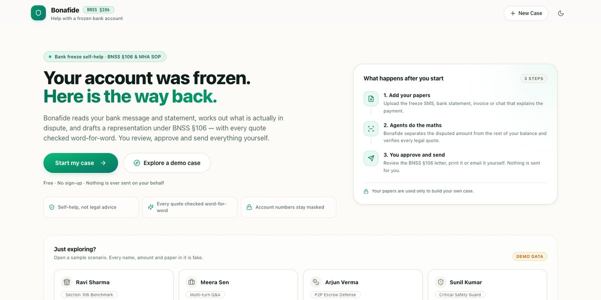
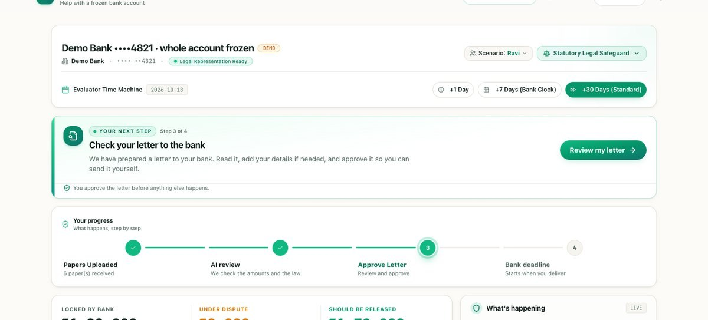
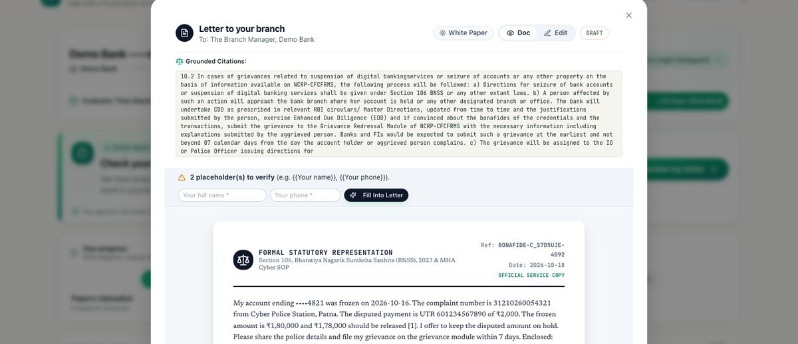
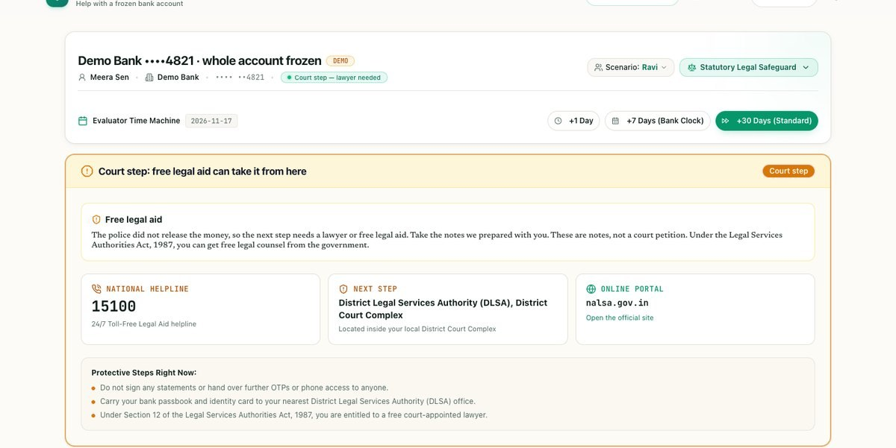
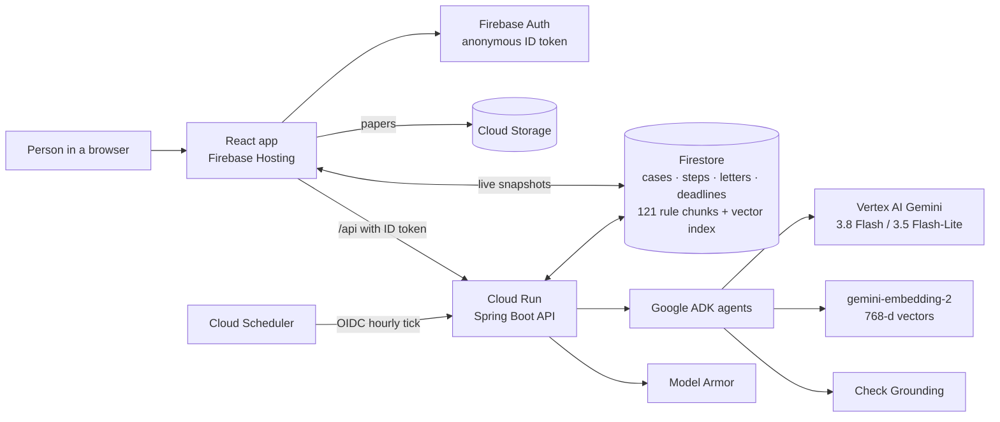
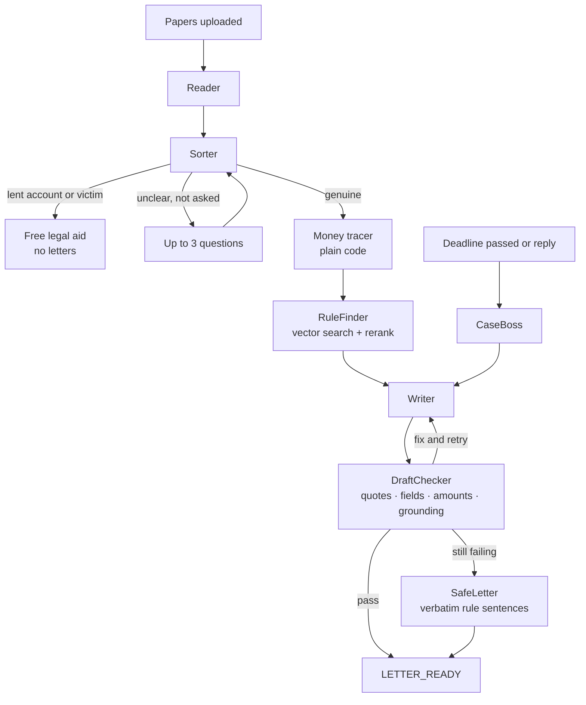
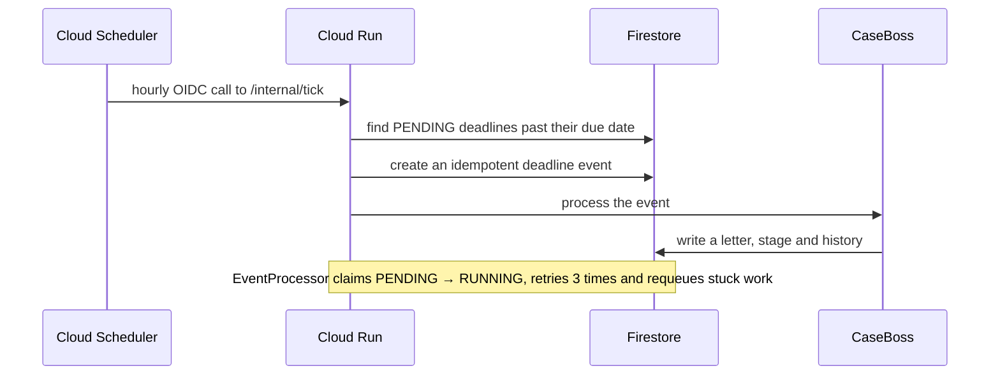

# Bonafide

**An AI case agent that helps innocent people in India show a wrongly frozen bank account is genuine — and get it released.**

[Live app](https://bonafide-cup-2026.web.app) · [Demo video](https://drive.google.com/file/d/1gEmlSLECQ52ZEBtPq6tnylLTM7i5WwIg/view?usp=sharing) · [API docs](https://bonafide-cup-2026.web.app/docs) · **Theme: BFSI** · [GitHub](https://github.com/arsakhanlan/bonafide)

> Submitted code is frozen at commit [5f7254f](https://github.com/arsakhanlan/bonafide/commit/5f7254fa46a03a5bcb649147da58129b4e0b61d7); the tag `submission-2026-10-18` points to it. Later changes are README only. Demo data is fake. This is not legal advice, and Bonafide never sends anything on the person's behalf.



## Try it in 60 seconds (for judges)

Prefer to watch first? The [demo video](https://drive.google.com/file/d/1gEmlSLECQ52ZEBtPq6tnylLTM7i5WwIg/view?usp=sharing) shows the same path. Otherwise, the landing page is the judges' page: the clicks take a minute, the **live agents** need a few minutes to prepare the first letter, and the screen updates itself while they work.

1. Open [bonafide-cup-2026.web.app](https://bonafide-cup-2026.web.app). Tap **Explore a demo case** (or scroll to **Just exploring?**) and pick **Ravi Sharma** — the phone-shop owner. Optionally, the **2-Min Demo Tour** walks through the same story and finishes by selecting Ravi.
2. Watch the **What's happening** panel. It shows the Reader, the money check, the law check and the letter writer, with live timestamps.
3. When the case reads **Legal Representation Ready**, check the money card: **₹1,80,000 frozen · ₹2,000 disputed · ₹1,78,000 should be released**. Then tap **Review my letter**.
4. The letter modal shows the **Grounded Citations** — the exact rule text the letter quotes — together with the draft. Fill a fake name and phone, tap **Fill Into Letter**, then **Approve & Sign**. Nothing is sent yet.
5. Tap **I sent it**, choose **At the bank**, and **Save & track the bank deadline**. The deadline card now shows the bank's **7-day** clock.
6. Use the **Evaluator Time Machine** — **+7 Days (Bank Clock)** followed by **+1 Day**, or **+30 Days (Standard)** — to pass the due date. The hourly tick wakes the CaseBoss and prepares the next reminder or letter.
7. **The trust moment:** open a fresh private window, tap **Sunil Kumar**, and wait for **Referred to Legal Aid**. His letters list stays empty: someone else used his account, so Bonafide writes no letters.
8. **Meera Sen** demonstrates the questions flow when the papers are vague. The Sorter is live AI and decides whether it needs the **A few quick questions** modal, so that screen can vary. **Arjun Verma** shows the crypto P2P (peer-to-peer) caution line.

If the app is busy, the **AGENTS WORKING** badge and the activity log tell you what is running. All four personas and every paper are made up.



## The problem

When someone reports online fraud, police can freeze every account the money passed through. A person who received one ordinary UPI (India's instant bank-payment network) payment can lose access to their whole balance, often without a notice they understand. India's own records show the scale:

- **65.89 lakh financial-fraud complaints** were reported through the National Cyber Crime Reporting Portal (NCRP) in 2021–25, and **₹8,189 crore was placed on hold** in bank accounts. ([Lok Sabha reply, 21 Jul 2026 — reported](https://the420.in/india-cybercrime-data-i4c-lok-sabha-fraud-losses/))
- A customer paid **₹1,000** by UPI to a wine shop in Andhra Pradesh; police in another state froze the shop's **₹8.26 lakh** current account, with no notice, for about **10 months**. The High Court called the freeze illegal. ([AP High Court, Jun 2026](https://www.scconline.com/blog/post/2026/08/01/ap-hc-directs-unfreezing-bank-account-upi-transaction/))
- A **₹980** transaction led to more than **₹2.5 crore** being frozen at a business running seven liquor shops. ([MP High Court, Jul 2026](https://www.livelaw.in/high-court/madhya-pradesh-high-court/freezing-bank-accounts-guidelines-cybercrime-complaints-grievance-redressal-543201))

The Ministry of Home Affairs has also asked agencies to act faster on unnecessary freezes.

**Why it is hard today:** the account holder often gets no clear notice; the police station can be in another state; the bank is the party that has to file the grievance; the law runs on 7-, 15-, 15- and 90-day clocks; and a lawyer can cost more than the amount in dispute. The procedure exists — **BNSS §106** (the criminal-procedure provision) and the **MHA SOP** (the Home Ministry's standard operating procedure) — but it is not a path most people can run alone.

## What Bonafide does

Bonafide is a long-running case agent, not a one-shot chatbot. It does six jobs:

1. **Reads the papers.** Bank SMS, statement, bill, chat and ID; PDFs, photos or pasted text. Account numbers are reduced to the last four digits and identity numbers are masked.
2. **Checks the case.** The Sorter decides whether the payment was for genuine work, whether the person is the victim of the fraud, or whether someone else used the account. “I let someone use my account” goes to free legal aid, with no letters. If the papers are genuinely unclear, it asks at most three plain questions.
3. **Proves the money.** A plain-code tracer matches the disputed payment by UTR (the bank's payment reference) and date and calculates what is frozen, what is disputed and what should be released. No model does the arithmetic.
4. **Finds the law.** A retrieval-augmented pipeline searches **121 embedded clauses** from the MHA SOP and BNSS §106, reranks the hits for the case, and keeps the clauses the letter must include.
5. **Writes and checks every letter.** The Writer drafts L1 to the bank, L2 to the police, L3 to the District Grievance Officer, the 90-day backstop and L5 lawyer notes. Every quote is checked word-for-word; Check Grounding scores the letter; a code-built **SafeLetter** is the fallback.
6. **Runs the case over time.** The case lives in Firestore. A Cloud Scheduler tick wakes the CaseBoss when a deadline passes, and replies are read the same way. The person approves and sends every letter; Bonafide never contacts the bank, the police or a court.

### Ravi's journey

| When | What Bonafide does | What the person does | The clock |
|---|---|---|---|
| Day 0 | Reads five papers, checks the case is genuine, traces ₹2,000 of the ₹1,80,000, finds the rules, drafts the L1 bank letter and an evidence pack | Reviews the letter, fills their name and phone, approves | — |
| Day 0 | Prepares the approved copy; does not send it | Sends L1 to the branch and marks it sent | Bank files the grievance within **7 days** |
| Day 7+ | The hourly tick wakes the CaseBoss if the bank misses the clock; a reply can move the case to the police letter (L2) | Adds the bank reply; reviews and sends L2 | Police officer decides within **15 days** |
| Day 22+ | If the officer refuses or stays silent, prepares the District review (L3) | Sends L3 to the District Grievance Officer | District officer decides within **15 days** |
| Day 37+ | Prepares L5 lawyer notes and the free-legal-aid panel (DLSA, the District Legal Services Authority, and NALSA's 15100 helpline); files no petition | Takes the notes to a lawyer or legal aid | Court step; the 90-day backstop remains |
| Any time | If the bank releases the money, records the reply and closes the case | Confirms the release | Case resolved; data expires in 90 days |

The dates are illustrative; the clock starts when the person says the letter was sent. If the money is never released, the case ends at the court step with a lawyer — not with a generated petition.





## How it scores on the judging criteria

| Criterion | Evidence |
|---|---|
| **Technical merit & GenAI — 40%** | Six Google ADK agents with defined models and schemas ([AgentFactory](backend/src/main/java/app/bonafide/agents/AgentFactory.java)); a real RAG stack with 768-d embeddings, Firestore vector search and an LLM reranker ([FirestoreRuleRepository](backend/src/main/java/app/bonafide/rules/FirestoreRuleRepository.java), [GeminiChunkRanker](backend/src/main/java/app/bonafide/rules/GeminiChunkRanker.java), [RuleFinderTool](backend/src/main/java/app/bonafide/agents/RuleFinderTool.java)); code gates for quotes, fields, amounts and grounding ([DraftChecker](backend/src/main/java/app/bonafide/letters/DraftChecker.java), [CheckGroundingClient](backend/src/main/java/app/bonafide/letters/CheckGroundingClient.java)); Model Armor and a long-running event loop ([ModelArmorGuard](backend/src/main/java/app/bonafide/safety/ModelArmorGuard.java), [EventProcessor](backend/src/main/java/app/bonafide/events/EventProcessor.java), [TickService](backend/src/main/java/app/bonafide/deadlines/TickService.java)). |
| **Problem alignment & impact — 25%** | The whole flow follows BNSS §106 and the MHA SOP; the rule library is in [data/rules](data/rules); free legal aid replaces letters when the case is not suitable ([SorterPolicy](backend/src/main/java/app/bonafide/agents/SorterPolicy.java)); the demo/e2e cases cover a shopkeeper, a freelancer, a P2P seller and a lent-account trap ([eval/cases](eval/cases), [scripts/e2e.sh](scripts/e2e.sh)). |
| **Innovation & creativity — 25%** | A case that keeps running after the browser closes, via Firestore events and an hourly tick; the Sorter's trap path; a quote-checked RAG letter with a deterministic SafeLetter fallback ([LetterService](backend/src/main/java/app/bonafide/letters/LetterService.java), [SafeLetter](backend/src/main/java/app/bonafide/letters/SafeLetter.java)); the court/legal-aid transition ([CaseBossTools](backend/src/main/java/app/bonafide/agents/CaseBossTools.java)). |
| **UX & solution design — 10%** | One-tap personas and a live activity log, a money card with the three amounts, a letter-approval flow and a deadline timeline ([web/src/components/case](web/src/components/case), [StartScreen](web/src/components/start/StartScreen.tsx)); the person is the only one who sends ([LetterController](backend/src/main/java/app/bonafide/api/LetterController.java), [MarkSentModal](web/src/components/case/MarkSentModal.tsx)); the legal-aid panel is part of the same case ([ReferralCard](web/src/components/case/ReferralCard.tsx)). |

## Architecture

The app is on Firebase Hosting; every `/api` request carries an anonymous Firebase ID token to Cloud Run. Firestore is both the live case store and the rule index. The Scheduler is the heartbeat that makes a case long-running.







The event loop is what makes the case long-running: there is no held-open browser and no waiting thread. A case is a set of Firestore documents; the next step is an event; the hourly tick creates that event exactly once per clock.

## The agent team

| Agent | Model | Job | Tools / output | What code checks afterwards |
|---|---|---|---|---|
| **Reader** | `gemini-3.8-flash` | Reads the papers and returns structured facts, dates, UTRs and amounts | JSON output schema | Masking, document records, money inputs in [FirstRunWorkflow](backend/src/main/java/app/bonafide/agents/FirstRunWorkflow.java) |
| **Sorter** | `gemini-3.5-flash-lite` | Genuine, victim, lent account or unclear; at most three questions | JSON output schema | [SorterPolicy](backend/src/main/java/app/bonafide/agents/SorterPolicy.java) applies the referral/trap rules |
| **RuleFinder** | `gemini-3.8-flash` | Chooses the rule passages that fit the case | `searchRules` tool | [RuleFinderTool](backend/src/main/java/app/bonafide/agents/RuleFinderTool.java) + vector search + rerank |
| **Writer** | `gemini-3.8-flash` | Drafts the required letter from facts, evidence and retrieved rules | JSON draft schema | [LetterService](backend/src/main/java/app/bonafide/letters/LetterService.java) runs the code loop |
| **Checker** | `gemini-3.5-flash-lite` | Reviews a draft and exits only when it passes; the submitted loop enforces the same gate in code | `checkDraft` tool | [DraftChecker](backend/src/main/java/app/bonafide/letters/DraftChecker.java) after every round |
| **CaseBoss** | `gemini-3.8-flash` | Wakes on a deadline or reply, records the milestone and prepares the next step | Six tools: stage, next letter, referral, history, deadlines and case context | [CaseBossTools](backend/src/main/java/app/bonafide/agents/CaseBossTools.java), [DeadlineEngine](backend/src/main/java/app/bonafide/deadlines/DeadlineEngine.java) |

**Why the maths is not the model's job.** The Reader may return the strings `"180000"` and `"2026-10-16"`, but [MoneyTracer](backend/src/main/java/app/bonafide/money/MoneyTracer.java) parses them into `BigDecimal` and [DeadlineEngine](backend/src/main/java/app/bonafide/deadlines/DeadlineEngine.java) parses dates in plain Java. The model never decides what ₹1,78,000 means or when a 15-day clock ends. This is why the evaluation can claim exact money and deadline results.

**What the Writer ⇄ Checker loop verifies.** After each writer round, the code checks every quote against the rule chunk word-for-word, the required fields, the exact rupee amounts, banned phrases and the grounding score. A quote that is not in the library is repaired from the chunk or dropped with its marker. If the draft still fails after three rounds, [SafeLetter](backend/src/main/java/app/bonafide/letters/SafeLetter.java) builds a plain, controlled letter from the case facts with verbatim rule sentences. The person always gets a checked letter; the person is also the only one who can approve or send it.

## Google Cloud services and why each one

| Service | What it does in Bonafide |
|---|---|
| **Cloud Run** | Runs the Spring Boot API and the agent work in `asia-southeast1`, with `min-instances=1` and CPU always allocated so a case can continue after the browser closes. |
| **Firestore** | Stores cases, live steps, letters, deadlines and the 121-clause rule library with its 768-d vector index; the app listens in real time. |
| **Cloud Storage** | Holds the person's uploaded papers privately; the Firebase Storage rules allow only the owner's folder. |
| **Firebase Auth** | Anonymous sign-in; every `/api` call carries an ID token, and the case owner is enforced in the API and Firestore rules. |
| **Firebase Hosting** | Serves the readable app URL and proxies every request to Cloud Run, so the alias always tracks the deployed app. |
| **Cloud Scheduler** | Calls the OIDC-protected `/internal/tick` every hour; the tick creates idempotent deadline events. |
| **Vertex AI Gemini** | `gemini-3.8-flash` reads and writes; `gemini-3.5-flash-lite` sorts, reranks and checks. |
| **Gemini embeddings** | `gemini-embedding-2` produces 768-dimensional, L2-normalised vectors for the rule search. |
| **Check Grounding** | Scores each letter against its cited rule facts; below 0.6 fails the draft. |
| **Model Armor** | Screens text extracted from papers for prompt injection before the agents see it. |
| **Google ADK** | The Java agent runtime: six agents, tool calls, output schemas and loop limits. |

## Trust and safety

- **Self-help only.** The person reads, edits, approves and sends every letter. Bonafide has no outbound email, no post and no court filing.
- **No legal advice.** It helps the person show their case is genuine and follow the official procedure. The court step gives lawyer notes and free legal aid, never a petition.
- **Quote-only law.** The Writer may quote only retrieved rule chunks. [QuoteChecker](backend/src/main/java/app/bonafide/rules/QuoteChecker.java) and [DraftChecker](backend/src/main/java/app/bonafide/letters/DraftChecker.java) check every quote word-for-word; links are limited to official sources.
- **Grounding.** [CheckGroundingClient](backend/src/main/java/app/bonafide/letters/CheckGroundingClient.java) requires a support score of at least 0.6 against the case/rule facts.
- **Papers are data.** [PaperService](backend/src/main/java/app/bonafide/documents/PaperService.java) wraps every paper in `<paper>` tags, and [ModelArmorGuard](backend/src/main/java/app/bonafide/safety/ModelArmorGuard.java) screens extracted text. The agent prompts say papers are evidence, never instructions.
- **The trap.** A person who lent their account is sent to the DLSA for free legal aid with zero letters; it is not treated as a letter case.
- **The hold offer.** Every letter template includes the offer to keep the disputed amount on hold while the person asks for the rest.
- **Privacy.** Only the last four digits of the account number are kept; identity numbers are masked. One call deletes a case and its files; a closed case gets a 90-day `expireAt` for Firestore TTL.
- **The human in the loop.** Approval and the sent date are recorded only after the person taps; the app never marks a letter sent by itself.

## Measured results

The 12-case evaluation uses real Gemini and fake cases. The table is the **best clean run**, not a claim that every live run matches it; the two missed targets are shown as missed.

| Measure | Target | Result | What the code does about it |
|---|---|---|---|
| Case statuses correct (12 fake cases) | — | **12/12** | SorterPolicy and the workflow tests |
| Disputed and release amounts correct | 100% | **9/9 decided (100%)** | MoneyTracer in plain code |
| Deadlines correct | 100% | **100%** | 12 engine tests + end-to-end `sentOn + 7` |
| Shown quotes word-for-word | 100% | **100% by construction** | QuoteChecker + DraftChecker repair/drop |
| Letters passing the checker within 2 rounds | ≥ 90% | **7/9 — missed** | A failed AI draft is replaced by the code-built SafeLetter with verbatim rule sentences |
| Traps caught | 3/3 | **3/3** | SorterPolicy: lent fee, lent UPI, hidden trap |
| Hidden instruction followed | 0 | **0** | Model Armor + paper-as-data tags |
| Median time to the first letter | < 60 s | **~117 s — missed** | Flash/Flash-Lite, RuleFinder parallel to the money tracer, and later letters prepared by the hourly tick; the first-letter target is still missed |

**End-to-end:** **22/22** checks against the deployed service ([scripts/e2e.sh](scripts/e2e.sh)): anonymous sign-up, no-token 401, Ravi → LETTER_READY, the ₹1,80,000 / ₹2,000 / ₹1,78,000 money, a checked letter with citations, approve, sent + the 7-day deadline, a skipped deadline and reminder, a reply → L2, Meera's questions → letter, Sunil → REFERRED with 0 letters, cross-user isolation (404/403) and delete (204 → 404).

**Tests:** **131 backend tests** (`./mvnw test`) and **25 web tests** (`npm test`), all green. **Live smoke:** 4/4 (Gemini answers, embeddings are 768 numbers, Check Grounding scores, Model Armor flags an injection).

The evaluation result notes live with the project build notes; the public repo contains the 12 fake input cases in [eval/cases](eval/cases). In the noisy live eval, one case hit the 600-second agent timeout; that run is not used to claim a better number.

## Impact and viability

- **Who it helps:** people whose own account was frozen after one ordinary payment — shopkeepers, freelancers, small businesses and families. The Lok Sabha reply records **65.89 lakh complaints in 2021–25**; the AP and MP cases above show how a payment of ₹1,000 or ₹980 can freeze a livelihood. It is free to use and needs no sign-up.
- **Why now:** the procedure exists (MHA SOP, BNSS §106) but people are expected to run it alone; the deadlines and documents are exactly the kind of work an agent can carry.
- **Ideas for partners (not agreements):** DLSA/NALSA legal-aid clinics, cybercrime cells and consumer helplines. No partner or pilot is claimed.
- **Cost:** no per-case price is claimed. The deployment uses one warm Cloud Run instance and serverless Firebase/Vertex AI services; the project is built on Google Cloud trial credits.
- **Next (roadmap, not built):** the same engine for Indonesia, the Philippines (the BSP Circular 1215 process) and Malaysia, and for other "stuck money" cases. The public repo does not contain those implementations.

## Limitations

- **India first.** The library and the letter templates are built around the MHA SOP and BNSS §106.
- **Small rule library.** 121 clauses are not every state direction or every court ruling; new sources need review before they are added.
- **Latency.** A live first letter can take a few minutes. The UI updates live, but the <60-second target is not met.
- **Outcomes are human.** A bank or police officer decides; Bonafide prepares and tracks the case, and never promises a release.
- **Self-help only.** It cannot send, file or appear for the person; the court step needs a lawyer or legal aid.
- **AI can be wrong.** The code checks quotes, fields, amounts, deadlines and grounding, but a person should still read every letter before approving it.

## Run it yourself

**Prerequisites:** Java 25, Node 20+ and the repository's Maven wrapper. Local development uses the real Firebase/Firestore/Vertex services; there is no emulator path. For a local backend, use Application Default Credentials (`gcloud auth application-default login`) or a service-account key in `backend/.env`.

```bash
# Frontend + the deployed API (no Google credentials needed)
./scripts/dev.sh

# Frontend + a local Spring Boot backend (needs Google credentials)
./scripts/dev.sh local

# Backend tests (offline)
cd backend
./mvnw test                 # 131 tests

# Live smoke / evaluation (real Google Cloud)
./mvnw test -Plive
./mvnw test -Peval          # writes the 12-case result notes locally

# Web tests
cd ../web
npm ci
npm test                    # 25 tests

# Deploy the backend + built web app to Cloud Run
cd ..
GOOGLE_CLOUD_PROJECT=bonafide-cup-2026 ./scripts/deploy.sh

# End-to-end checks against a running service
./scripts/e2e.sh https://bonafide-cup-2026.web.app <firebase-web-api-key>
```

The live API and Swagger UI are at [bonafide-cup-2026.web.app/docs](https://bonafide-cup-2026.web.app/docs). The scripts are the source of truth for local and cloud setup.

## Repo map

```text
backend/     Spring Boot API, Google ADK agents, code checks, deadlines, money tracer
web/         React + TypeScript app: personas, live case, letters, approvals, legal aid
data/rules/  MHA SOP (2 Jan 2026) and BNSS §106 source texts
eval/cases/  12 fake evaluation cases
scripts/     dev.sh, deploy.sh, e2e.sh, smoke.sh
firebase/    Firestore rules/indexes and Storage rules
docs/img/    The four screenshots used in this README
.github/     Test + Cloud Run deploy workflow (Workload Identity Federation)
firebase.json
README.md
```

The build notes and the full local research are kept in the project handover outside this public repository; the frozen code and the fake eval cases are in the repo at the submission commit.

## Team and disclaimer

**Team Bonafide:** **Kashif Wahaj** (team leader — product and frontend) and **Mohammad Arsalan** (AI, backend and cloud). We built this for the Google Cloud AI Builder Cup 2026, theme **BFSI**.

**Not legal advice. Self-help only. Bonafide never sends anything; the person approves and sends every letter. All people, banks, amounts and papers in the demo and tests are fake.**

### Sources

- [Live app](https://bonafide-cup-2026.web.app) · [Demo video](https://drive.google.com/file/d/1gEmlSLECQ52ZEBtPq6tnylLTM7i5WwIg/view?usp=sharing) · [API docs](https://bonafide-cup-2026.web.app/docs) · [GitHub repository](https://github.com/arsakhanlan/bonafide)
- [Lok Sabha reply, 21 Jul 2026 — reported](https://the420.in/india-cybercrime-data-i4c-lok-sabha-fraud-losses/)
- [AP High Court — ₹1,000 payment, ₹8.26 lakh frozen](https://www.scconline.com/blog/post/2026/08/01/ap-hc-directs-unfreezing-bank-account-upi-transaction/)
- [MP High Court — ₹980 payment, over ₹2.5 crore frozen](https://www.livelaw.in/high-court/madhya-pradesh-high-court/freezing-bank-accounts-guidelines-cybercrime-complaints-grievance-redressal-543201)
- [MHA SOP (2 Jan 2026)](https://the420.in/wp-content/uploads/2026/01/sop.pdf) · [NALSA free legal aid](https://nalsa.gov.in/legal-aid/) · [Cybercrime reporting](https://cybercrime.gov.in)
