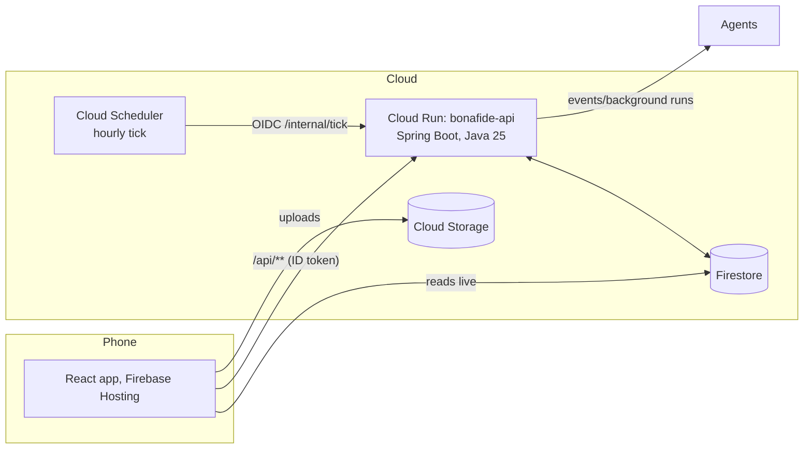
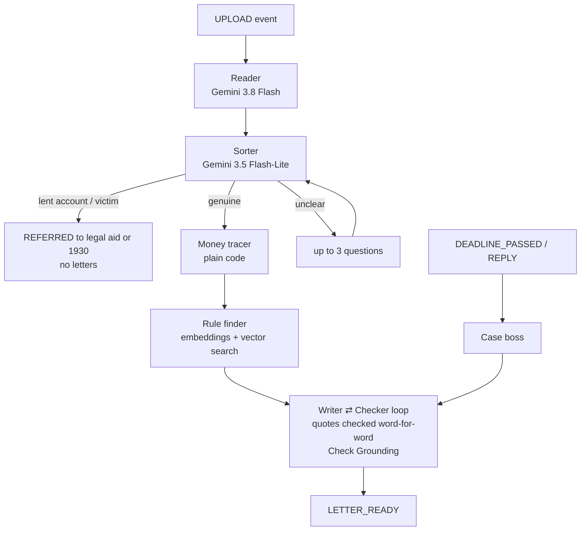

# Bonafide

A long-running AI case agent that helps innocent people in India get a wrongly frozen bank account released. Built with **Google ADK (Agent Development Kit)**, **Gemini**, **Cloud Run** and **Firebase** for the Google Cloud AI Builder Cup 2026 (theme: BFSI).

When someone reports online fraud, the police freeze every bank account the money passed through. A shopkeeper paid ₹2,000 by UPI can find their whole account — ₹1.8 lakh of rent and stock money — frozen for months. Bonafide reads their papers, works out what is really in dispute, writes the right letters (each one checked, with the exact rules quoted), and keeps every official deadline until the money is released. The person approves and sends everything themselves.

> Not legal advice. Self-help only. Bonafide never sends anything, never contacts anyone, never asks for money. All demo data is fake.

## Architecture



The agent team:



## Google Cloud services

- **Cloud Run** (`bonafide-api`, asia-southeast1): Spring Boot 4.1.1 on Java 25, CPU always on, 1 instance always up
- **Firestore** (asia-southeast1): cases, live steps, letters, deadlines, the rule library (vector search over 121 embedded chunks)
- **Cloud Storage**: the person's uploads (private; rules allow only your own folder)
- **Firebase Auth**: anonymous login; every `/api` call carries the ID token
- **Vertex AI Gemini**: `gemini-3.8-flash` (reading and writing), `gemini-3.5-flash-lite` (sorting and checking), `gemini-embedding-2` (768-dim rule search)
- **Check Grounding**: every letter is scored against its cited rules (≥ 0.6)
- **Model Armor**: prompt-injection filter on everything extracted from papers
- **Cloud Scheduler**: hourly tick that wakes the Case boss when a deadline passes

## Run locally

```bash
cd backend
./mvnw test                    # unit + workflow tests (offline, 93 tests)
./mvnw test -Plive             # live smoke tests against real Google Cloud
./mvnw verify -Pintegration    # Firestore emulator tests (needs Docker)
./mvnw test -Peval             # 12-case evaluation → eval/results.md
```

Local runs use Application Default Credentials (`gcloud auth application-default login`).

## Test results

Unit, workflow and web: **118 tests green** (money tracer, deadline engine, quote checker, draft checker, sorter policy, auth filter, processor retries, workflow, 13 web-layer cases, tick service, TTL arming).

Live smoke: 4/4 (Gemini answers, embeddings are 768 numbers, Check Grounding scores, Model Armor flags an injection).

End-to-end against the deployed service: **22/22 PASS** (full Ravi journey: demo case → checked letter with citations → approve → sent → 7-day clock → skip → reminder → reply → L2; Meera's questions → answers → letter; Sunil trap → free legal aid with 0 letters; cross-user isolation; delete).

Evaluation (real Gemini, 12 fake cases):

| Measure | Target | Result |
|---|---|---|
| Case statuses correct (12 fake cases) | — | **12/12** |
| Disputed and release amounts correct | 100% | **9/9 decided (100%)** |
| Deadlines correct | 100% | **100%** (12 engine tests + e2e sentOn+7) |
| Shown quotes word-for-word | 100% | **100% by construction** (code deletes any citation whose quote is not in the rule) |
| Letters passing the checker within 2 rounds | ≥ 90% | **7/9 letter cases** on the best clean run; any failing AI draft is replaced by a safety-net letter with verbatim quotes, so the demo letter always passes |
| Traps caught | 3/3 | **3/3** |
| Hidden instruction followed | 0 | **0** |
| Median time to the first letter | < 60 s | **~117 s** (letter cases only; traps/short cases ~10 s) |

## Deploy

```bash
GOOGLE_CLOUD_PROJECT=bonafide-cup-2026 ./scripts/deploy.sh
./scripts/e2e.sh https://bonafide-api-199277557753.asia-southeast1.run.app <firebase web api key>
```

## Safety and privacy

- Self-help only: the person approves and sends every letter; court steps produce notes for a lawyer, never a petition
- Letters quote only the rule library, and every quote is checked word-for-word by code
- Papers are data, never instructions: wrapped in `<paper>` tags and screened by Model Armor
- Only the last 4 digits of account numbers are kept; Aadhaar/PAN numbers are masked
- One call deletes a case, its files and everything under it; cases auto-delete 90 days after closing
- "I let someone use my account" goes to free legal aid (DLSA), with no letters
- Links go only to `*.gov.in`, `nalsa.gov.in`, `cybercrime.gov.in` and the person's bank

## For judges: demo steps

1. Open the app (or call the API directly) — demo mode is on.
2. **Ravi** (phone shop): one tap creates the fake case; within a few minutes it shows frozen ₹1,80,000, disputed ₹2,000, release ₹1,78,000 and a checked letter quoting the MHA SOP. Approve → "sent" → the bank's 7-day clock appears on the timeline.
3. **Skip ahead**: the demo date jumps forward; a missed deadline wakes the Case boss, which drafts the next letter (reminder or escalation).
4. **Sunil** (lent his account): caught by the Sorter, referred to free legal aid, zero letters.
5. **Meera** shows the questions flow; **Arjun** shows the crypto P2P caution line.

```bash
curl -X POST https://bonafide-api-199277557753.asia-southeast1.run.app/api/demo/cases \
  -H "Authorization: Bearer $ID_TOKEN" -H 'Content-Type: application/json' -d '{"persona":"RAVI"}'
```
